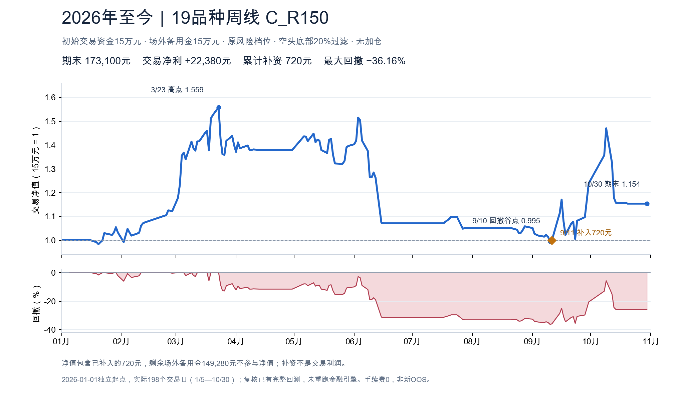

# 2026年至今：19品种周线 C_R150

口径：2026-01-01独立账户起点；实际交易日2026-01-05—2026-10-30，共198日。初始交易资金15万元、场外备用金15万元。保留空头历史底部20%过滤与原风险档位，多头不加额外价格/斜率过滤，无加仓。

本段已包含在Stage014完整回测中：本次复核并单独展示原fresh_engine窗口，不重新运行金融引擎，不从2015总曲线切片。当前m0002固定alpha与此研究规则相同；人工核验/真实转账时延和真实成交不由该历史研究证明。

| 指标 | 数值 |
|---|---:|
| 期末交易权益（包含已到账补资） | 173,100元 |
| 交易净盈利（扣除补资） | 22,380元 |
| 交易净利润 / 初始交易资金 | 14.92% |
| 展示净值增长（含补资） | 15.40% |
| 最大回撤 | -36.16% |
| 账户Sharpe（含已补资） | 0.620 |
| 累计补资 | 720元，1次 |
| 场外剩余备用金（不计净值） | 149,280元 |
| 模型成交次数 / 完整交易轮次 | 36 / 18 |
| 完整轮次胜率 | 44.44%（8盈10亏） |
| 平均盈利 / 平均亏损绝对值 | 13,370元 / 8,458元 |
| 平均盈亏比 | 1.581 |
| Profit Factor（总盈利 / 总亏损绝对值） | 1.265 |
| 总滑点 / 手续费 | 2,930元 / 0元 |
| 末未平仓净MTM | 0元 |
| 模型保证金×1.65 / 权益峰值 | 93.82% |
| 模型保证金超100%天数 | 0 |

今年盈利，但利润经历明显回吐：3月23日权益233,840元，9月10日回落至149,280元，构成36.16%最大回撤。9月11日出现合格多头信号前补入720元，交易权益补到15万元；其余149,280元始终留在场外。未使用备用金不能被画进交易净值。

图中1月1日为初始资金点，不是虚构行情或成交；198行daily.csv只包含真实交易日。账户净值=交易权益/150000，包含已补入T，因此15.40%不是剔除现金流后的策略收益；纯交易净利润22,380元不含720元补资。

核验和限制：原74输出来源SHA重新核验，逐日权益/现金/备用金守恒通过；独立本轮审查另见Stage019_review系列。成本沿用原模型，手续费0、固定滑点，保证金×1.65为静态研究估计，不等于券商历史真实比例；历史非完整PIT、非新OOS、next-daily-open执行与容量限制保留。没有改当前策略、物料、生产或定时任务，没有连接CTP/SMTP或启动HTTP服务。

过拟合判断：本次不调参，未增加优化性过拟合；重复查看已用样本不构成新OOS。继续价值：核清今年的盈亏/回撤路径；不据此扫描起点、品种或风险参数救收益。

数据文件：daily.csv、monthly.csv、deposits.csv、trades.csv、summary.json与source_manifest.json。
