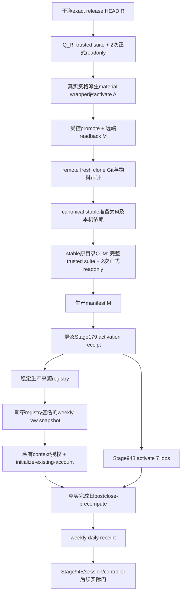

# Stage024 新m4实际安装顺序：只读代码核对

2026-11-02，line_id=futures_weekly_short_ma_slope_gate。作者仅读取现有CLI/API、Stage022/018记录及Skill；没有运行下文命令，没有CTP连接、Git mutation、安装、launchctl、SMTP、订单或生产修改。本文没有账户、持仓或金额明细。m4尚须由root最终冻结/审查，所有S/R/A/M都是未来实际值，不能拿m3或旧诊断替代。

## 身份与顺序结论

- S：m4 manifest.source_commit，即冻结前源码提交。
- R：只提交不可变m4 release的精确release commit；候选资格要求当前HEAD=R且S=R的父提交。
- A：本地activate只修改CURRENT所产生的activation commit。
- M：受控promote-master得到、远端独立readback及fresh clone确认的master提交。
- production release-manifest.source_commit、最终qualification.source_commit、stable HEAD必须都是M；material.source_commit仍是S，不混用。
- root已只读确认远端现有master可达；该旧SHA不构成本次m4晋升、资格或安装。后续必须读取真正M，不能把预先可达视为完成。



图中Stage948 activation与initialization可按准备状态先后安排；关键是静态receipt不等于launchd activation audit，创建registry/初始化并不要求先有daily receipt。首个daily receipt不应被倒造来“满足安装”。

## 1. 候选R的trusted qualification

实际CLI：`build_qmt_roll_stage179_production_qualification_bundle.py`。它没有--source-commit、--execution-profile、--runtime-env、--reuse-captures等参数。source取repo HEAD；profile取当前配置；候选扩展通过以下两个material参数显式绑定。

下面只作模板；私有根的直接父目录须先已存在且0700，output-dir必须外置于repo且不存在。所有占位值由root据真实提交/审查填写。

```sh
"${weekly19_release_repo}/.py311/bin/python" \
  "${weekly19_release_repo}/examples/portfolio_backtesting/build_qmt_roll_stage179_production_qualification_bundle.py" \
  --repo-root "${weekly19_release_repo}" \
  --output-dir "${weekly19_private_root}/qualification-R" \
  --review-report "${weekly19_private_root}/review-R.json" \
  --material-release-id "${weekly19_material_id}" \
  --material-release-commit "${weekly19_release_commit}" \
  --confirm-trusted-production-qualification-run \
  I_APPROVE_RUNNING_EXACT_TESTS_AND_TWO_FORMAL_CTP_READONLY_CAPTURES
```

真实约束与准备：

1. repo必须HEAD=R、完全clean（含untracked）。assert_exact_release_commit与verify_release_tree校验candidate；manifest.source_commit必须等于R^，top-level runtime/config字节与该release inventory一致。不是对尚有未提交m4改动的source树运行。
2. review-R.json不是本线任意partial review回执。需私有canonical JSON，artifact_kind=independent_production_review_report，source_commit=R、tree_fingerprint覆盖实际DEFAULT_CRITICAL_FILES加该material critical闭包，findings是实际独审结果；P0/P1/P2不能自填为零掩盖未审内容。
3. `.py311`须为本机完整依赖；环境身份实际读取本repo的0600、当前owner、regular非symlink `examples/portfolio_backtesting/ctp_live.local.env`。它固定校验Python、两个vnpy_ctp扩展、正式MD/TD framework二进制SHA，正式libs优先于.py311/lib。repo运行数据/数据库等ignored依赖须就绪且Git仍clean；LFS要实际对象而非pointer。
4. builder自己用受控、不继承caller的HOME/TMPDIR/environment逐个运行PRODUCTION_REQUIRED_TEST_SUITES；不会复用Stage024离线CI的XML。缺JUnit、非零退出、failed、skipped或source/runtime漂移均拒绝。实际主机sysctl/PGID/日志权限须可用，不能在会造成既知sandbox失败的执行环境里再声称资格通过。
5. suite后固定2次Stage907，实际argv为`--mode refresh --env-profile production-live --wait-seconds 30 --confirm-readonly-refresh I_UNDERSTAND_THIS_RUNS_CTP_READONLY_REFRESH_ONLY --email-policy never`。受控env打开readonly gate；Stage907 source本repo的ctp_live并设置正式framework，Stage174做实际新查询。这是本轮真实连接，不是读取旧9:04结果。
6. 两次独立invocation/query generation、完整account/positions/orders/trades/contracts、stdout/文件/原始artifacts同源、原生attempted/called计数零都重核。formal gate允许positions_received，不要求初始E恰15万或空仓；它不证明现仓已合法接管。
7. Q_R输出qualification.json及全部相对引用artifact。不是只保留单个JSON；后续不得修改其中source/head/路径/计数冒贴新身份。

源码定位：trusted builder `_resolve_qualification_critical_files`、`_run_trusted_pytest_inputs`、`_run_trusted_readonly_inputs`、`build_trusted_production_qualification_bundle`；release builder `_production_runtime_identity`、`derive_formal_ctp_readonly_capture`。

## 2. material activation、promote与fresh remote clone

**格式差异不能忽略**：Q_R的完整Stage179 qualification.json没有material activate要求的status/release_commit/evidence_ids格式，不能直接用作--qualification-json。现有material发布器没有自动转换CLI；root须在真实full validator通过后派生并保留实际证据引用的material wrapper。最小字段为status passed/qualified、release_commit R、order/cancel API零、非空真实evidence_ids；可记录原bundle路径与SHA。不能仅为了过`assert_qualification_passed`手填passed。实际send零也应来自完整formal bundle核验。

```sh
"${weekly19_release_repo}/.py311/bin/python" \
  "${weekly19_release_repo}/examples/portfolio_backtesting/build_qmt_roll_official_strategy_material_release.py" \
  activate --repo-root "${weekly19_release_repo}" \
  --release-id "${weekly19_material_id}" --release-commit "${weekly19_release_commit}" \
  --qualification-json "${weekly19_private_root}/material-qualification-R.json" \
  --confirmation "I_UNDERSTAND_THIS_ACTIVATES_OFFICIAL_STRATEGY_MATERIALS:${weekly19_material_id}"
```

publisher输出实际A。然后：

```sh
"${weekly19_release_repo}/.py311/bin/python" \
  "${weekly19_release_repo}/examples/portfolio_backtesting/build_qmt_roll_official_strategy_material_release.py" \
  promote-master --repo-root "${weekly19_release_repo}" \
  --release-id "${weekly19_material_id}" --release-commit "${weekly19_release_commit}" \
  --activation-commit "${weekly19_activation_commit}" \
  --qualification-json "${weekly19_private_root}/material-qualification-R.json" \
  --governance-path "${weekly19_governance_file}" \
  --remote origin --target-branch master \
  --confirmation "I_APPROVE_COMPLETE_OFFICIAL_PROMOTION_TO_MASTER:${weekly19_material_id}"
```

每个需要同步的治理文件重复--governance-path。发布器从inventory复制允许的top-level源码/tests/skills、合并material/CURRENT，再加显式治理路径；不是任意整树推送。不接受symlink/绝对路径/..。要求activation中的qualification对象与本次传入完全相同；fetch/push间远端漂移、非FF或readback不一致阻断。

fresh clone必须来自真正远端master，不是来源worktree的本地clone；核M、active CURRENT m4、S/R、顶层与payload、ruleset、完整LFS对象和可执行位。现`audit_qmt_roll_official_promotion_closure.py`没有--git-only开关；它是含production的最终审计。安装前可用`assert_official_checkout_matches_active_material`、`verify_release`与Git/clone readback分别留下静态证据，不应把full audit因旧生产尚未切换而失败的结果涂成passed。

## 3. Stage948先准备stable，再在原stable目录做Q_M

### 实际已存在stable的阻塞

`install_qmt_roll_stage948_official_live_production.py`固定MAIN=~/Desktop/person/vnpy、STABLE=~/Desktop/person/vnpy_production_live，无--repo-root覆盖。prepare_stable_worktree仅在stable不存在时git worktree add；若已存在但HEAD不是M，直接production_install_stable_head_mismatch，**不会自行checkout/升级旧stable**。

root须在用户已授权的受控切换流程里安排旧stable完整备份/迁移、保留本地私有资产和回滚来源，再确保canonical MAIN可解析M对象、canonical stable最终就是M。不能手拷源码覆盖生产、删掉旧证据或假传source_commit。本作者未执行任何这些操作。

```sh
"${weekly19_install_source}/.py311/bin/python" \
  "${weekly19_install_source}/examples/portfolio_backtesting/install_qmt_roll_stage948_official_live_production.py" \
  --source-commit "${weekly19_master_commit}" \
  --confirm-prepare I_UNDERSTAND_THIS_PREPARES_C9_15W_PRODUCTION_ASSETS
```

prepare只准备本机assets和7个staged plist；CTP/launchctl/订单计数应零。它建立精确venv/data链接、拷本机0600 env、准备本机数据库/数据feed配置与私有目录；不自动生成production qualification、manifest、activation receipt或weekly context。ctpenv/datafeed秘密只本地，不回显、不入Git。

### 生产资格必须在canonical stable原目录

`load_and_validate_production_qualification_evidence`比较trusted_runner及每个runner_row的cwd_realpath。**在另一个fresh-master clone跑出的Q_M不能直接搬来stable使用**，即使HEAD与全部代码字节一样。因此：fresh clone先做远端/物料审计，stable准备成M后，第二轮trusted完整suite与2次新正式readonly必须在canonical stable目录运行。此时不要再传candidate material-release-commit R，否则候选resolver会以HEAD!=R拒绝；active CURRENT已是m4，走默认active闭包。

```sh
"${weekly19_stable}/.py311/bin/python" \
  "${weekly19_stable}/examples/portfolio_backtesting/build_qmt_roll_stage179_production_qualification_bundle.py" \
  --repo-root "${weekly19_stable}" \
  --output-dir "${weekly19_state_root}/qualification-bundle" \
  --review-report "${weekly19_private_root}/review-M.json" \
  --confirm-trusted-production-qualification-run \
  I_APPROVE_RUNNING_EXACT_TESTS_AND_TWO_FORMAL_CTP_READONLY_CAPTURES
```

若canonical qualification-bundle已有旧代，不覆盖历史，应先由root保留旧代再创建目标；也可外部新目录运行后受控保留整套relative artifacts。review-M须为M/实际critical tree的正确报告，不将review-R的source_commit直接改字冒认复审。Q_R不能替代Q_M，旧readonly也不能改source标签挪用。

### 生产manifest与静态receipt

```sh
"${weekly19_stable}/.py311/bin/python" \
  "${weekly19_stable}/examples/portfolio_backtesting/build_qmt_roll_stage179_release_manifest.py" \
  --output "${weekly19_state_root}/release-manifest.json" \
  --release-id "${weekly19_runtime_release_id}" --execution-profile weekly19-15w-r150k \
  --material-release-id "${weekly19_material_id}" --allow-production-live \
  --production-qualification-evidence "${weekly19_state_root}/qualification-bundle/qualification.json" \
  --confirm-production-live-manifest I_UNDERSTAND_THIS_BUILDS_A_C9_15W_PRODUCTION_LIVE_RELEASE_MANIFEST

"${weekly19_stable}/.py311/bin/python" \
  "${weekly19_stable}/examples/portfolio_backtesting/build_qmt_roll_stage179_activation_receipt.py" \
  --repo-root "${weekly19_stable}" \
  --output "${weekly19_state_root}/runtime/state/activation_receipt.json" \
  --release-manifest "${weekly19_state_root}/release-manifest.json" \
  --production-qualification-evidence "${weekly19_state_root}/qualification-bundle/qualification.json" \
  --confirm-production-activation I_APPROVE_C9_15W_PRODUCTION_LIVE_ACTIVATION_RECEIPT
```

manifest builder CLI没有--repo-root，因此必须调用stable内脚本（或显式API repo_root）；默认execution-profile仍C9，必须显式weekly。确认字符串中的C9是既有控制面名字，不能自行改字符串。两个artifact按实际validator拒绝漂移/不同覆盖，root要保留旧代而不是覆盖历史。静态receipt不连接CTP，也不要求loaded jobs/daily receipt。

## 4. source registry、私有启动context与initialization

现有生产capture delegation是Python API，无对应自动发布CLI：

```python
create_capture_authority_registry(
    registry_path, qualification_path=..., qualification_sha256=...,
    expected_account_key=..., material_release_id=..., execution_profile='weekly19-15w-r150k',
    source_commit=M, official_version=..., critical_files=...,
    manifest_created_at_utc=..., now=aware_now,
    capture_kinds=('stage174_query','native_push','warm_epoch_snapshot'),
    production_release_manifest={'path': ..., 'sha256': ...},
    production_activation_receipt={'path': ..., 'sha256': ...})
```

必须从canonical stable的M源码调用；full Q_M、manifest、静态receipt和active material都真验过。key/registry只外部0700/0600私有文件，禁止用material候选/调用方qualified:true替代。用户取消的自动TransferSerial不必为了本次安装纳入producer或capture kind。

registry就绪后才做带签名的weekly Stage907 capture，实际CLI支持：

```sh
OFFICIAL_LIVE_PHASE_D_READONLY_REFRESH_ENABLED=1 \
OFFICIAL_LIVE_OUTPUT_DIR="${weekly19_state_root}/official-live" \
"${weekly19_stable}/.py311/bin/python" \
  "${weekly19_stable}/examples/portfolio_backtesting/run_qmt_roll_stage907_official_live_readonly_refresh_gate.py" \
  --mode refresh --env-profile production-live --wait-seconds 30 \
  --confirm-readonly-refresh I_UNDERSTAND_THIS_RUNS_CTP_READONLY_REFRESH_ONLY --email-policy never \
  --weekly19-material-release-id "${weekly19_material_id}" --weekly19-execution-profile weekly19-15w-r150k \
  --weekly19-private-capture-dir "${weekly19_private_capture_dir}" \
  --weekly19-capture-authority-registry "${weekly19_registry_path}" \
  --weekly19-capture-authority-sha256 "${weekly19_registry_sha256}"
```

trusted正式资格的2captures不依赖此registry，所以没有“先registry才能qualification”的cycle；但那两份formal证据不自动等于初始化所需的source-qualified weekly原生cost capture。必须新取M/current registry绑定、仍fresh的实际source，不能重贴旧Stage023诊断。

私有context路径由945/947固定为`$state_root/runtime/weekly19/context.json`。至少准备真实schema/profile/account/release/cold_start_date/target_date、state_path/mail_outbox/daily_receipt_path、market_data（asset_root/expected_hashes/forward_calendar）、broker（summary/manifest/private capture dir/policy trusted hashes及registry ref）、execution_ledger_path，以及新mode `initial_account_mode=operator_existing_account_v1`、固定cash_verification_mode=operator_manual_v1、startup_authorization ref。实际内容由root按既有backend消费字段填写，不能用此清单捏造账户事实。

startup授权body严格字段为schema/account_key/material_release_id/cold_start_date/completed_day/adoption_scope/authorized_positions/contract_metadata/operator_authorization，ref原bytes SHA成为operator_decision_id；actual quantity必须仍与fresh snapshot精确匹配。nested metadata packet为Stage024.contract-metadata-capture.v1，内含weekly19.contract-metadata.v1 / tqsdk_quote_capture原始quote envelope、producer source SHA、零API记录；当前repo只有loader/seed API，未发现专门生成该packet的CLI，root还需真实只读producer输出，不是自动flag或fixture。基金与接管state同actor一次保存，不能捏造历史entry/stop。

初始化命令：

```sh
"${weekly19_stable}/.py311/bin/python" \
  "${weekly19_stable}/examples/portfolio_backtesting/run_qmt_roll_weekly19_live.py" \
  --job initialize-existing-account --execution-profile weekly19-15w-r150k \
  --context-file "${weekly19_state_root}/runtime/weekly19/context.json" \
  --release-manifest "${weekly19_state_root}/release-manifest.json" \
  --activation-receipt "${weekly19_state_root}/runtime/state/activation_receipt.json" \
  --production-qualification-evidence "${weekly19_state_root}/qualification-bundle/qualification.json"
```

无--preview；该job不经launchd scheduler，不是第8个job，不发送邮件/委托。它要求stable production静态链与fresh source，但不要求daily receipt；重复只能核对已初始化身份并普通reconcile，不重新seed/reset stop。

## 5. Stage948 activation与首个daily receipt

```sh
"${weekly19_stable}/.py311/bin/python" \
  "${weekly19_stable}/examples/portfolio_backtesting/install_qmt_roll_stage948_official_live_production.py" \
  --activate-prepared \
  --confirm-activate I_UNDERSTAND_THIS_LOADS_C9_15W_PRODUCTION_LAUNCHD_JOBS
```

activation读取canonical stable M、Q_M、production manifest、静态receipt、prepared 7plist及rollback journal；不要求weekly daily receipt或首个decision。只允许Stage948原子写/bootout/bootstrap/核7label与conflict0；不能手工增加第8job或逐个复制。需实际返回production_launchd_activated_no_ctp_connection，不能仅凭文件存在。

当前实际repo plist：precompute 15:10、report 15:30、day-close readonly 15:12、day-session 08:55/13:25、night 20:55、health 09:03/13:33/21:03、monthly disabled job 18:20；RunAtLoad均False。旧Skill表仍16:35/16:55，后续应由root文档/新物料统一，操作以实际冻结plist为准，不能默默假设旧时刻。

initializer保存fund+protected runtime，**decision仍None**。它使用较早completed_day做warmup，不能直接发行当日daily receipt。首次postclose-precompute应等待target达到cold_start_date且真完成：Stage947weekly路由不要求预先daily receipt；它先正常source/market刷新，再process_completed_day并绑定decision origin，`backend.complete_postclose`写weekly production daily receipt。target<cold_start的support/session只skip；不要倒改cold_start追单历史，也不要手工把warmup改成decision。

首个receipt就绪后，Stage945与controller读取它、校calendar/下一session/source/config/capture authority/actual state，再进入既有最终send门。receipt未就绪只代表暂未具备会话条件，不需要反复重装Stage948。跨日人工cash review仍按原人工模式，不强制已取消的自动bank/final parser；实际fresh账户与现金gross变化门不取消。

最终完整审计CLI：

```sh
"${weekly19_stable}/.py311/bin/python" \
  "${weekly19_stable}/examples/portfolio_backtesting/audit_qmt_roll_official_promotion_closure.py" \
  --repo-root "${weekly19_remote_fresh_clone}" --production-root "${weekly19_stable}" \
  --production-state-root "${weekly19_state_root}" --launchd-install-dir "${weekly19_launchagents}" \
  --remote origin --branch master --expected-release-id "${weekly19_material_id}"
```

## 本次真实阻塞清单（不编造已通过）

1. m4未最终冻结/独审/精确R真实资格，不能复用m3、旧9:04或离线CI作trusted证据。
2. material wrapper与production full bundle格式不同，需真实验证后有据派生；review-R/review-M也不是partial stage JSON直接改名。
3. 旧stable存在且不是M时prepare必拒；MAIN需有M对象，需root受控迁移与保留私有资产，不是CLI自动升级。
4. 最终Q_M有cwd绑定，必须canonical stable目录重跑；fresh master clone资格不能原样搬入。
5. runtime依赖/权限、LFS实体和trusted sandbox条件要真实满足；不能修改测试或伪造host字段解决。
6. 正式资格之后还需stable-M registry、fresh signed raw source、真实metadata packet与私有context，才可初始化；没有自动metadata packet CLI不应伪造成功。
7. 首次完成日decision/receipt与当前management日期有时间依赖，未就绪只能会话fail-closed，不是安装循环。

过拟合：否，只读检查治理/启动接口，无alpha或金融回测。继续价值：是，避免把source/cwd/静态receipt/loaded jobs/daily readiness混成一个“已安装”。本记录不代表上述任何变更已执行或资格已通过。
